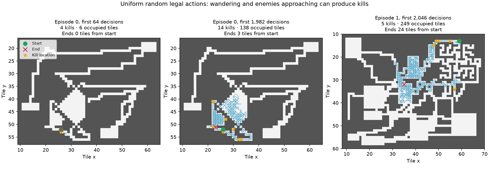

# Why the untrained full-map policy gets kills

2026-09-16. Production environment, 24 enemies, 2048 physical turns, 32 validation maps × 32 episodes = 1024 episodes per policy. All policies start from the same environments; stochastic trajectories subsequently diverge. No simulator rules or training settings changed.

| Policy | Kills | Clear % | Death % | Game turns | Successful moves | Unique occupied tiles | Attack attempts | Rest uses |
|---|---:|---:|---:|---:|---:|---:|---:|---:|
| uniform | 5.48 | 0.00 | 52.2 | 1142 | 862 | 114 | 37.4 | 1.37 |
| untrained | 5.25 | 0.00 | 51.8 | 1139 | 861 | 112 | 35.7 | 1.27 |
| wall-blind | 2.48 | 0.00 | 74.5 | 714 | 318 | 54 | 19.1 | 0.62 |
| trained-5m | 11.11 | 3.03 | 49.8 | 1096 | 830 | 119 | 71.1 | 0.29 |

## Mechanism

The untrained network is almost uniform over legal actions: its mean per-state maximum deviation from uniform is only 0.047 percentage points. Uniform random actions reproduce the roughly five-kill baseline. This does not require learned navigation or combat.

Walls are masked out of the production action distribution. Uniform random therefore chooses among about 4.94 passable directions on average, plus wait and occasionally rest. Letting it waste direction choices on wall bumps reduces kills from 5.48 to 2.48. This control changes both movement efficiency and the probability of attacking adjacent enemies.

Random movement still averages 862 successful steps, 114 distinct occupied squares, and maximum Chebyshev displacement 17.3 tiles from spawn. Many steps revisit old squares, but low net displacement does not imply staying still. The median maximum displacement is 17 tiles.

There are initially 1.70 enemies within six tiles on average; 77.1% of placements have at least one. Waking ignores walls in this experiment. Awake enemies use path distances to pursue the player. Across an episode at least 7.23 enemies wake and 7.07 reach adjacency on average. Only 1.11 of the 5.48 kills were initially inside the wake radius, so later wandering also matters.

The player is adjacent to an enemy on 143 decisions per episode, and chooses an attack on 26.2% of those decisions. That gives 37.4 attack attempts, 29.7 damaging hits, and 68.7 HP removed. Ordinary enemies have 8–16 HP; these attacks account for the kills. The observed hit rate is 79.3%, consistent with the implemented 80% hit chance.

The player regenerates 0.23 HP per physical turn (one HP per approximately 4.35 turns), including movement and combat, capped at 18 HP. Waiting is not required for this passive regeneration. Armour, evasion and shield checks also apply to enemy attacks. We did not separately ablate regeneration or defences in this audit.

Rest is available on only 8.50 of 1115 decisions per episode; uniform random selects it on 16.1% of eligible decisions. It averages 1.37 uses and 27.8 physical resting turns. Full health or awake enemies within seven tiles usually block it.

## Concrete trajectory

Uniform-random episode 0, validation map 62655: in its first 64 decisions it visits only six squares and kills four enemies. At each killing blow the player is at its spawn square or one square away. Those enemies started four to six tiles away and approached the player. Across the entire episode it visits 138 squares, kills 14 enemies, and ends only three tiles from spawn. This is an illustrative high-kill episode, not the average. Episode 1 has the median five kills and visits 249 squares.

## Learning comparison and scope

The saved 5.01M checkpoint averages 11.11 kills versus 5.25 for the saved untrained policy. It visits 119 versus 112 occupied tiles and makes 71.1 versus 35.7 attack attempts. This comparison describes what changes with training; it does not isolate the contribution of global-map understanding from local combat and movement preferences. One training seed is insufficient for a general learning claim.

At 5M the maximum displacement grows to 27.4 tiles (untrained: 17.2), and observed awake enemies grow to 13.06 (untrained: 7.03). Distinct occupied tiles barely increase, so the movement change reaches farther without broadly covering much more floor. Conditional on an adjacent enemy, attack frequency rises from 26.1% to 44.6%. It reaches more enemies and attacks more often when adjacent. Geometry and the number of adjacent enemies can also change that conditional attack frequency, so this does not isolate improved combat choices; a causal decomposition would require further controls.

Rest usage decreases with training despite increased eligibility: 0.29 uses from 22.1 eligible decisions per episode, or 1.33% of eligible decisions. Thus the trained policy is choosing rest less often, while low random-policy rest counts mainly reflect masking.

Every reported kill in all four audits coincides with a directional attack on an adjacent enemy with at most four HP. On nonterminal transitions, the kill-count increment also matches disappearance of a living enemy HP record. No kill-count inconsistency was found. This is a targeted accounting check, not a proof that all simulator mechanics are correct.

Wake and adjacency totals omit changes during the final auto-resetting transition and are lower bounds. Hit/damage totals omit non-killing damage on terminal death/timeout turns. Model audits use AMP; original initialization validation used FP32, so sampled trajectories need not match exactly. Audit wall times include contention with ongoing training and must not be read as standalone inference benchmarks.

Scripts and reproduction commands: [diagnostics/centered-map-random/README.md](diagnostics/centered-map-random/README.md). Raw JSON summaries: `results/centered-map-random-*.json`; bulk traces remain local under ignored `learning-runs/centered-map-random-audit/`.
