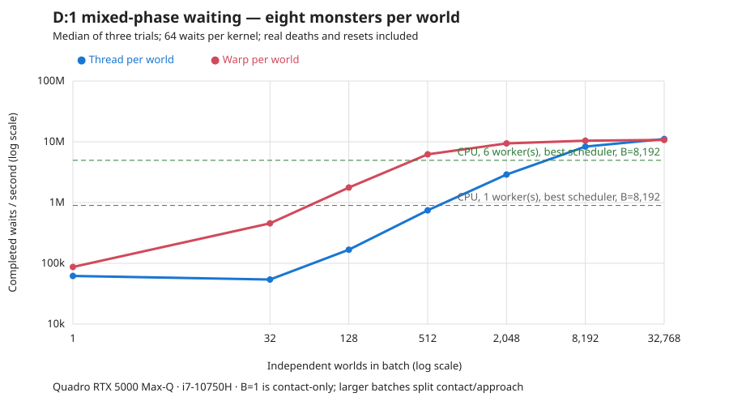

# D:1 wait prototype: measurements and limits

For the subsequent movement/attack task and measured PPO learning results, see [LEARNING.md](LEARNING.md), [LEARNING-SLEEP.md](LEARNING-SLEEP.md), and [LEARNING-V2.md](LEARNING-V2.md). The measurements below remain those of the original wait prototype.

The prototype runs the restricted D:1 workload on both CPU and CUDA. It achieves useful GPU acceleration for large batches, with substantial differences between quiet waiting, contact combat, and navigation through crowds. These are resident simulation rates, including real player damage, deaths, and resets. They exclude policy inference and per-step CPU readback.

**Sustained comparison.** The final comparison uses 8,192 independent worlds, eight monsters per world, mixed approach/contact phases, 64 waits per kernel, and exactly 4,096 waits per world per trial: **33,554,432 transitions per trial on every backend**. Both CPU schedulers are measured. Rates below are medians of three trials; ranges show the minimum and maximum.

| Backend | Scheduler | M waits/s | Trial range, M/s | Time per 8,192-world step |
|---|---|---:|---:|---:|
| CPU, 1 worker | scan | 0.827 | 0.823–0.845 | 9.902 ms |
| CPU, 1 worker | heap | 0.896 | 0.874–0.904 | 9.148 ms |
| CPU, 6 workers | scan | 4.600 | 3.920–4.644 | 1.781 ms |
| CPU, 6 workers | heap | 4.954 | 3.358–4.967 | 1.654 ms |
| GPU, thread per world | scan | 8.505 | 8.502–8.506 | 0.963 ms |
| GPU, warp per world | scan | 10.165 | 10.159–10.180 | 0.806 ms |
| CPU, 12 workers | scan | 2.123 | 2.027–3.646 | 3.859 ms |
| CPU, 12 workers | heap | 2.706 | 2.522–3.732 | 3.028 ms |

The fastest GPU result is **10.16 million waits/s**, **2.05×** the faster six-worker CPU result and **11.35×** the faster single-worker CPU result. Twelve CPU workers did not improve performance in this implementation; six workers remain the stronger baseline. The cause of the twelve-worker slowdown was not profiled.

All final sustained trials have exactly matching activity counters: 279,852,180 monster actions, 183,791,239 attacks, and 2,310,643 deaths per trial. CPU and warp final checksums also match exactly at this full scale.

The fixed-action rollout benchmark measures parallel simulation throughput. A GPU kernel running 64 waits does not allow a policy to choose a different action between those waits. The one-wait-per-kernel results below address launch granularity, while still excluding policy execution and CPU readback.

**Batch size matters.** The shorter mixed-phase sweep, with the scan scheduler and eight monsters, produced:

| Worlds | Thread per world, M waits/s | Warp per world, M waits/s |
|---:|---:|---:|
| 1 | 0.062 | 0.087 |
| 32 | 0.054 | 0.455 |
| 128 | 0.168 | 1.766 |
| 512 | 0.745 | 6.221 |
| 2,048 | 2.892 | 9.406 |
| 8,192 | 8.337 | 10.431 |
| 32,768 | 11.115 | 10.727 |

At batch one, the mixed initializer produces a contact-only world; it cannot represent both cohorts. All larger listed batches split approach and contact populations equally. This explains part of the small-batch irregularity. These results do not establish lower latency for an individual decision. The warp layout fills the GPU at smaller batch sizes; the thread layout catches up at large batches.

**Crowding is expensive.** At batch 2,048, using the best measured scheduler for each listed backend:

| Monsters/world | CPU, six workers, M waits/s | Best GPU, M waits/s | GPU layout | Ratio |
|---:|---:|---:|---|---:|
| 1 | 139.66 | 594.78 | Thread | 4.26× |
| 8 | 4.96 | 9.37 | Warp | 1.89× |
| 32 | 0.483 | 0.857 | Warp | 1.77× |
| 64 | 0.210 | 0.443 | Warp | 2.11× |

The one-monster run becomes almost entirely contact combat. Larger populations exercise occupancy and the bounded repair search. The 32/64-monster cases are synthetic stress populations, not natural D:1 spawn distributions. The CPU heap wins these six-worker comparisons; the warp's cooperative maximum-energy scan beats its scalar heap. For example, at 32 monsters the warp scan gives 0.857 M/s versus 0.750 M/s for the warp heap. There is no universal winning layout or scheduler.

**Workload changes the answer.** With batch 2,048 and the scan scheduler:

| Workload | CPU, six workers, M waits/s | GPU thread, M waits/s | GPU warp, M waits/s |
|---|---:|---:|---:|
| Quiet, zero monsters | 2,086 | 6,038 | 1,420 |
| Approach, eight monsters | 3.08 | 2.00 | 5.26 |
| Contact, eight monsters | 9.35 | 80.01 | 47.40 |
| Mixed phases, eight monsters | 4.29 | 2.89 | 9.34 |

Quiet waiting is an extremely cheap control and is not the headline result. Contact combat avoids navigation and keeps much of the work in registers. The approach fixture eventually reaches combat: roughly 65% of its turns include movement and 51–52% include an attack. In the mixed workload, approximately 32% of turns include movement, 76% include combat, and each wait resolves about 8.34 monster actions and 5.48 attacks. Movement and combat fractions can overlap. About 6.9% of mixed waits end in death; the next wait includes the resident reset.

The Zot clock and other long-term world effects are excluded in both implementations. Deaths here are combat deaths, and quiet waiting can continue indefinitely. The single-rat lifetime comparison below also uses this restricted rule.

**Launch and observation costs.** Final warp results at batch 2,048, eight monsters, mixed phases:

| Waits/kernel | Simulation only, M waits/s | With observation, M waits/s |
|---:|---:|---:|
| 1 | 5.443 | 5.425 |
| 64 | 9.330 | 9.346 |
| 256 | 9.340 | 9.310 |

Observation means writing current HP, shield-block count, and visible monster positions into a device buffer after every step. It does not encode a full agent observation tensor or transfer it to the CPU. The small differences with observation enabled are close to run variability; these results support a small cost for this particular buffer, not free arbitrary observation construction.

**Geometry and combat validation.** The native seed is **1057**. It has 836 connected floor cells, ordinary opaque walls, and inert stairs/exit. No geometry was carved to improve GPU timing. Selection was based on supported terrain, before performance measurements. Its sole map marker is a passive stair feature marker; active/non-feature markers are rejected by fixture compilation. The raw export retains the original 14 monsters, floor-item records, and player inventory. The benchmark deliberately replaces that population and relocates the player to `(31,45)`; all changes are in [the manifest](fixtures/manifest.json).

The native player has 18 HP, +0 long sword, +0 scale mail, +0 buckler, and two inert potions of might. Exported defense numerators are AC=681/100, EV=794/100, and native shield-class input=906/100. The shield-class input is not displayed SH. Fractional defenses are randomly rounded in the supported native formulas; the buckler permits two blocks per wait. Regeneration accumulates 23/100 HP per normal wait.

- Independently flattened native ray bitsets match native LOS for **1,618,400 local origin/target pairs**, with zero mismatches.
- Exact compact CPU/GPU tests cover 0, 1, 8, 32, and 64 monsters; both GPU layouts; both schedulers; 37-world batches with partial final blocks; 257 steps; observations; RNG state; final actor state; and all counters. Separate checks cover chunk boundaries, energy accounting, occupancy bijections, and heap/scan trajectory identity.
- The native combat oracle calls Crawl's actual hit, shield, and damage primitives. It tests six monster types and three prior-block counts, with 300,000 attacks per case. All 18 cases meet the specified six-standard-error tolerances. Maximum differences are 0.151 percentage points for blocks, 0.420 percentage points for dodges, and 0.00372 HP per attack for mean damage. The damage tolerance uses a conservative bounded-variance estimate.
- Native and compact lifetime checks use 100,000 waits per case, with independent random streams:

| Eight-monster fixture | Native mean lifetime | Compact mean lifetime | Relative difference | Native p10 / p50 / p90 | Compact p10 / p50 / p90 |
|---|---:|---:|---:|---|---|
| Contact | 9.684 | 9.623 | −0.63% | 6 / 9 / 14 | 6 / 9 / 14 |
| Approach | 28.608 | 29.576 | +3.38% | 24 / 28 / 33 | 25 / 29 / 36 |

The single-rat timing check produces exactly one monster action per wait in both implementations. Its long-tailed survival comparison has only 89–91 completed episodes, so its lifetime quantiles provide much weaker evidence than the eight-monster cases. The approach comparison also has different movement/contact frequencies: similar survival statistics do not establish native path equivalence.

Host AddressSanitizer and UndefinedBehaviorSanitizer pass the 64-monster CPU case with observations and resets. CUDA Compute Sanitizer could not instrument even the smoke kernel on this installation; the error log is retained. Device memory/race sanitization is therefore **not verified**, despite passing exact state and occupancy tests.

**Native reference timing.** The instrumented native driver sustains approximately **12,012 contact waits/s** or **15,234 approach waits/s** for eight monsters. The matching single-worker compact CPU scenarios give 1.896 M/s and 0.554 M/s: approximately **158×** and **36×** respectively. These are gains from restricted rules, compact representation, cached work, and different navigation/engine overhead—not GPU speedups.

The native driver executes `handle_monsters(false)` and actual melee resolution, with a restricted regeneration/reset harness. It strips monster equipment and ground items, refreshes hostile targets, and suppresses sound and messages. Death/reset costs remain timed. It does not run the entire unmodified `world_reacts()` loop. Native uses its O2/assertions build; compact code uses O3. See [SOURCES.md](SOURCES.md) for every hook and caveat. Repeated native timing trials replay the same seeded work; they are not additional independent lifetime samples.

**Method and reproduction.** Hardware is an i7-10750H (six physical cores, twelve logical CPUs) and Quadro RTX 5000 Max-Q, 16 GiB, compute capability 7.5. CUDA is 12.0, the driver is 595.84, and the CUDA host compiler is GCC 12. Each backend uses an appropriate actor/occupancy layout: contiguous worlds across lanes for the thread kernel, and contiguous actors within a world for the warp kernel and CPU. CPU timing uses OpenMP workers; the main matrix does not pin worker affinity.

GPU event time and synchronized wall time are both recorded; reported rates use wall time. Compilation, initial state construction/upload, warmup, final readback, and validation are outside the timed segment. In-world reset is inside it. Trial state is reinitialized, and RNG continues across episode resets. Short matrix runs use adaptive segment lengths, so comparisons there are rates for the same workload distribution, not equal-length traces. The final sustained table uses equal-length traces. Background desktop services remain; CPU clocks/placement and laptop cooling can affect variability. No power settings were changed.

The explicit device arrays occupy **93,597,088 bytes (89.3 MiB)** at batch 8,192 with eight monsters, or 356.4 MiB at batch 32,768. This excludes CUDA context and compiler-managed stack/local-memory overhead. Static fixture compilation takes about 1.8 seconds, including exhaustive LOS verification. At batch 2,048, final launch tests record roughly 48–59 ms of host state construction, 110–126 ms of CUDA setup/initial upload, and 2.4–2.5 ms for the full final-state readback. These costs would matter for short-lived jobs; the main rates assume resident batches.

Commands are in [README.md](README.md). [summary.csv](results/summary.csv), [matrix.jsonl](results/matrix.jsonl), [baselines.jsonl](results/baselines.jsonl), [sustained.jsonl](results/sustained.jsonl), and [launch.jsonl](results/launch.jsonl) contain the measurements. The final launch file supersedes launch rows in the initial matrix after an explicit warp observation barrier was added. [environment.json](results/environment.json) records hardware, flags, and source/fixture fingerprints. Native validation and sanitizer logs remain under `results/`.

**What this supports.** Compact representation yields the largest improvement over native engine overhead. GPU batching adds a useful further gain, especially for contact combat, but navigation/crowding sharply reduces throughput. The next worthwhile performance work is the bounded repair search and broader map/position coverage. Adding movement/player attacks, additional D:1 monsters, awareness, or mutable terrain requires new rules and fresh measurements. This result is evidence for the restricted wait prototype, not a measured full D:1 port.

Latest completed ogre, optional-label and pressure-curriculum results: [OGRE-RESULTS.md](OGRE-RESULTS.md).
